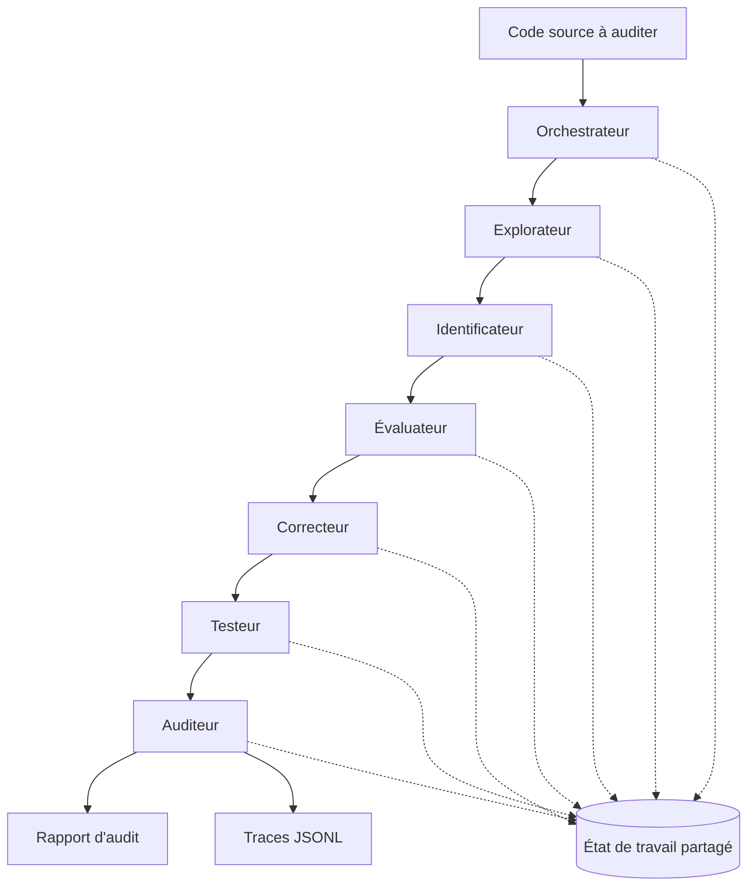

# Architecture du système

L'architecture de **Hash-Audit AI** repose sur un modèle multi-agents. Chaque agent intervient à une étape précise de l'audit afin d'identifier les mécanismes de hachage, d'évaluer les risques et de produire des recommandations de sécurisation.

---

## Vue d'ensemble

Le système s'organise autour de trois éléments :

- **Un orchestrateur** : coordonne les opérations et distribue les tâches.
- **Six agents spécialisés** : réalisent les différentes étapes de l'audit.
- **Un mécanisme de traçabilité** : conserve les opérations et facilite leur analyse.

## Les six agents spécialisés

| Agent | Mission | Résultat attendu |
|---|---|---|
| Explorateur | Collecte et analyse les éléments à auditer. | Éléments pertinents identifiés |
| Identificateur | Repère les mécanismes de hachage utilisés. | Mécanismes identifiés |
| Évaluateur | Analyse les risques associés aux mécanismes détectés. | Évaluation des risques |
| Correcteur | Propose des recommandations de sécurisation. | Mesures correctives proposées |
| Testeur | Vérifie les résultats produits. | Résultats contrôlés |
| Auditeur | Contrôle et synthétise les opérations réalisées. | Synthèse de l'audit |

## Schéma de l'architecture

## Orchestration des agents

L'orchestrateur assure la coordination des agents et organise le déroulement de l'audit.

Les agents s'appuient sur un état de travail partagé pour échanger les informations nécessaires au traitement. Des traces permettent également de suivre les opérations effectuées.

!!! info "À retenir"
    L'architecture est conçue pour répartir l'analyse en plusieurs étapes spécialisées. Les agents sont coordonnés par l'orchestrateur et ne constituent pas six applications indépendantes.

## Technologies utilisées

| Technologie | Utilisation dans le projet |
|---|---|
| Python | Développement de l'application et des agents |
| Argon2id | Référence de stockage sécurisé des mots de passe |
| bcrypt, scrypt, PBKDF2-SHA256 | Comparaison des mécanismes de dérivation |
| Ollama | Exécution facultative de modèles d'IA locaux |
| JSONL | Enregistrement des traces d'audit |
| Pytest | Tests automatisés du projet |

## Intégration de l'intelligence artificielle

L'intégration d'Ollama est facultative. Elle permet d'utiliser des modèles de langage locaux lorsque l'environnement est configuré pour cela.

Les audits en lot peuvent fonctionner sans appel à un modèle de langage. Les résultats et recommandations nécessitent toujours une validation humaine.

## Traçabilité et résultats

Les opérations d'audit peuvent être enregistrées au format **JSONL**. Ces traces facilitent le suivi des traitements, l'analyse des opérations et la compréhension des résultats produits.

Les résultats sont destinés à aider à repérer les pratiques de stockage des mots de passe qui nécessitent une amélioration. Ils ne constituent pas une certification de sécurité ni un audit professionnel de production.

---

[← Retour à l'accueil](index.md)
